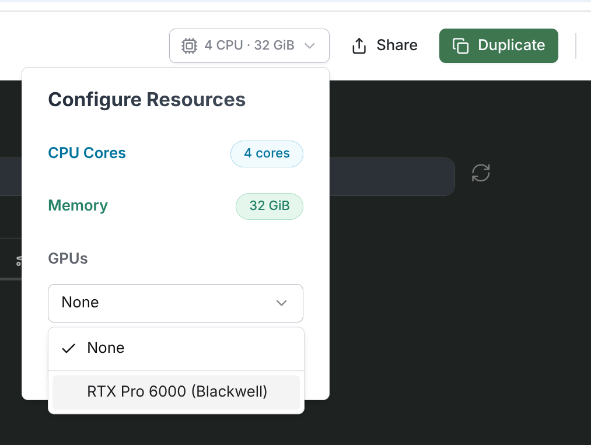
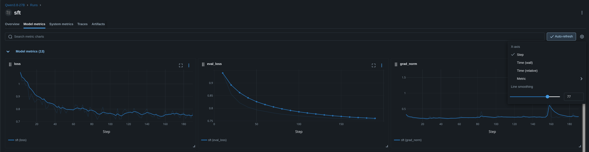
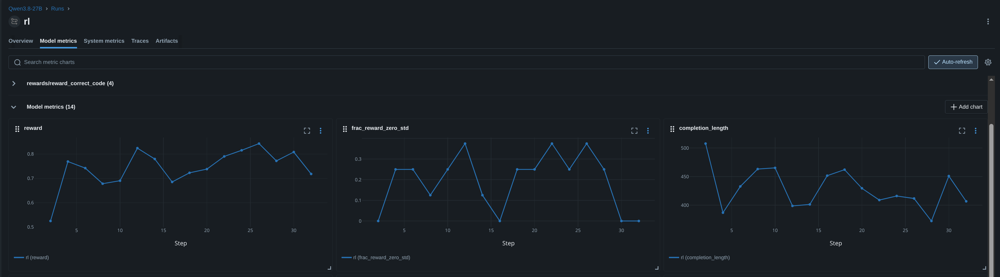
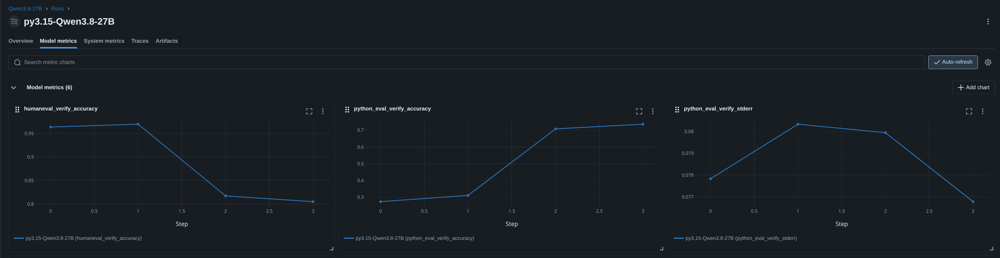
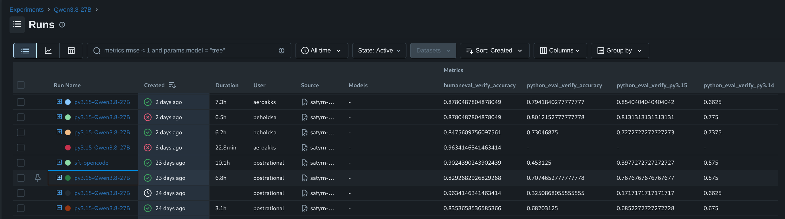

# Fine-tuning Satyrn language models for Python 3.15

Satyrn models are local language models fine-tuned to work as agents in coding harnesses such as Pi and to write
code using features of latest Python versions. This tutorial will show you how to train your own Satyrn model 
and compare its evaluation scores with other runs.

You can follow these steps in a terminal of any Linux machine with an Nvidia GPU, such as a
[RunPod](https://www.runpod.io/) VM or a [Molab notebook](#run-the-tuning-in-a-marimo-notebook).

## Prepare the environment

Run the following commands to install Git LFS (Large File Storage), which is needed to download datasets,
and install all the Python versions used during training for model evaluation and reinforcement learning.

> [!NOTE]
> If you're in a Molab notebook, open the Developer Panel at the bottom of the screen and switch to the Terminal tab.

```shell
apt update
apt install -y git-lfs
git lfs install

uv python find 3.13 || uv python install 3.13
uv python find 3.14 || uv python install 3.14
uv python find 3.15 || uv python install 3.15
```

### Clone and install satyrn-models

Clone the `satyrn-models` repository (or your fork of it) and check out the branch you want to train from.
Then install our Unsloth trainer, which provides the `satyrn-unsloth` command.

```shell
git clone -b main https://github.com/satyrn-ai/satyrn-models.git
cd satyrn-models
uv pip install --config-file uv.toml \
  --extra-index-url https://download.pytorch.org/whl/cu130 \
  --index-strategy unsafe-best-match \
  -e trainer/unsloth/
```

> [!NOTE]
> `--index-strategy unsafe-best-match` lets uv pick each package's best version from `pytorch.org` or `pypi.org`.

### Prepare the secrets file

The trainer reads your Hugging Face and MLflow credentials from a `.env` file.
Copy `.env.example` from the repo into a `.env` file (next to your notebook if using Marimo):

```shell
cd ..
cp satyrn-models/.env.example .env
```

Then fill in the following values. In Molab, you can open and edit the file from the Files side panel.

```shell
export HF_USERNAME=
export HF_TOKEN=
export MLFLOW_TRACKING_USERNAME=
export MLFLOW_TRACKING_PASSWORD=
```

### Download the model

Check out the [model config](https://github.com/satyrn-ai/satyrn-models/tree/main/trainer/unsloth/configs/model) of
the model you want to train. Its `name` field is the model's Hugging Face repo ID, which you can use to download the
model.

If you source your `.env` file first, `hf` will use your Hugging Face token, which speeds up the download.

```shell
source .env
hf download unsloth/Qwen3.8-27B
```

> [!NOTE]
> The `hf` command comes from the `huggingface-hub` package, which you can install with `pip install huggingface-hub`.
> This command is preinstalled on Molab.

## Fine-tuning

### Prepare the experiment command

To start fine-tuning, run the `satyrn-unsloth` command with the name of the experiment configuration you want to use:

```shell
satyrn-unsloth --config-name experiment/py3.15-qwen3.8-27b
```

Pick one of the existing [experiment configs](https://github.com/satyrn-ai/satyrn-models/tree/main/trainer/unsloth/configs/experiment),
or use the name of a new YAML file you added to `experiment` on your branch.

The configuration is handled by [Hydra](https://hydra.cc/docs/intro/), which is a framework for creating modular
and composable configurations. We are using the pre-release Hydra version 1.4.

Hydra also lets you override any config value on the command line. It's good practice to set `run_name` to a short,
informative string, which will help you identify the run in MLflow and in logs.

You can run only selected stages of training (`cpt`, `sft` or `rl`) by setting the datasets of the other stages to
`null`:

```shell
satyrn-unsloth --config-name experiment/py3.15-qwen3.8-27b \
  run_name=py3.15-rl-only \
  datasets.cpt=null \
  datasets.sft=null
```

See [defaults.yaml](https://github.com/satyrn-ai/satyrn-models/blob/main/trainer/unsloth/configs/defaults.yaml) for
the complete list of configuration fields.

#### Tweak tuning hyperparameters

To check how changing hyperparameter values affects the results, you can override them on the command line. For
example, to change the SFT learning rate and the LoRA rank:

```shell
satyrn-unsloth --config-name experiment/py3.15-qwen3.8-27b \
  run_name=py3.15-r32 \
  sft.learning_rate=1e-4 \
  model.peft.r=32
```

`model.peft.lora_alpha` defaults to twice the rank, so it changes along with `model.peft.r`.

> [!IMPORTANT]
> Here are some ideas for things we can try to improve the performance of our tuned models:
>
> | Idea                                                     | Config keys                                                  |
> |----------------------------------------------------------|--------------------------------------------------------------|
> | Tweak the [learning rate][lora-lr] of each stage         | `cpt.learning_rate`, `sft.learning_rate`, `rl.learning_rate` |
> | Tweak the [PEFT LoRA][lora] parameters of the model      | `model.peft.r`, `model.peft.lora_alpha`                      |
> | Change the number of [epochs][lora-epochs]               | `sft.num_train_epochs`, `rl.num_train_epochs`                |
> | Change [batch size][lora-batch] to match your GPU's VRAM | `cpt.batch_size`, `sft.batch_size`, `rl.batch_size`          |

To learn more about tweaking fine-tuning, take a look at Unsloth's
[Fine-tuning LLMs Guide](https://unsloth.ai/docs/get-started/fine-tuning-llms-guide/).

[lora]: https://unsloth.ai/docs/get-started/fine-tuning-llms-guide/lora-hyperparameters-guide
[lora-lr]: https://unsloth.ai/docs/get-started/fine-tuning-llms-guide/lora-hyperparameters-guide#learning-rate
[lora-epochs]: https://unsloth.ai/docs/get-started/fine-tuning-llms-guide/lora-hyperparameters-guide#epochs
[lora-batch]: https://unsloth.ai/docs/get-started/fine-tuning-llms-guide/lora-hyperparameters-guide#effective-batch-size

#### Select tuning stages and datasets

As mentioned above, you can disable a stage by setting its datasets to `null`, for example `datasets.cpt=null`.

You can also train a stage on a customized list of dataset files:

```shell
satyrn-unsloth --config-name experiment/py3.15-qwen3.8-27b \
  run_name=py3.15-custom-sft \
  "datasets.sft=[\
    datasets/python3.14/sft.jsonl,\
    datasets/python3.14/sft-PEP750.jsonl,\
    datasets/python3.15/sft.jsonl,\
    datasets/python3.15/sft2.jsonl,\
    datasets/opencode-reasoning/opencode_reasoning_split1.jsonl]"
```

This example changes the list of files which will be combined into the SFT stage dataset.

> [!IMPORTANT]
> The size and quality of our training datasets are key to achieving good results.
> Here are some things we can experiment with:
>
> - Our CPT dataset is made of the sections of the Python documentation which changed in each version. It's unclear if this stage of tuning improves the model's performance. Compare tuning with and without the CPT stage.
> - We currently have SFT datasets which include:
>   - Python 3.14 and 3.15 conversations generated by DeepSeek V4 from the Python docs and PEPs
>   - Coding problems with reasoning traces converted from Nvidia's [OpenCodeReasoning](https://huggingface.co/datasets/nvidia/OpenCodeReasoning) dataset (`datasets/opencode-reasoning`)
> - We don't have SFT datasets which represent tool-calling agentic interactions with the harness. This is a weak spot we should fill.
> - We have very limited reinforcement learning datasets. We should improve these.

> [!NOTE]
> You can generate new CPT, SFT and RL datasets with the `satyrn-dataset` command from the `corpus_builder` package,
> as described in the [dataset generation guide](dataset_generator.md).

#### Upload trained model to Hugging Face

In order to perform further tests on your model or publish it, you can upload it to your account on the Hugging Face Hub.
Set `push_to_hub=true` and when training finishes, the model will be converted to 16-bit safetensors and a 4-bit quantized
GGUF file and pushed to the Hub:

```shell
satyrn-unsloth --config-name experiment/py3.15-qwen3.8-27b \
  push_to_hub=true
```

### Run the tuning in a Marimo notebook

This section assumes you will run fine-tuning inside a [Molab](https://molab.marimo.io/) notebook.
Molab is a cloud service for running [Marimo](https://marimo.io/) notebooks, which can run on a machine with a GPU.

#### Prerequisites

You will need a Molab account. Once you're signed in, create a new notebook and open its resource settings to select a GPU.



Now open the notebook's terminal and run the commands from [Prepare the environment](#prepare-the-environment).

#### Setup cells

To run training from your notebook, you'll need to add a few setup cells.

This first cell prepares the notebook's Python environment for the trainer.

```python
import os
import sys

# Set the import path to include the trainer package
sys.path.insert(0, "/marimo/satyrn-models/trainer/unsloth/src")

# Change the working directory to the repo, dataset paths in configs are relative to it
os.chdir("/marimo/satyrn-models")

# Molab sets PYTHONSAFEPATH=1, so llama.cpp's GGUF converter child process needs its directory on PYTHONPATH
os.environ["PYTHONPATH"] = f"{os.path.expanduser('~/.unsloth/llama.cpp')}:{os.environ.get('PYTHONPATH', '')}"
```

The second cell defines `run_training`, a function which will run a `satyrn-unsloth` command in a separate thread.
This is needed because the model evaluations start their own event loop, which would clash with the one Marimo is running.

```python
import shlex
import threading

from satyrn.trainer.unsloth.run import main


def run_training(command: str) -> None:
    sys.argv = shlex.split(command)
    thread = threading.Thread(target=main)
    thread.start()
    thread.join()
```

#### Start the training

In the last cell you can start a run with the same command and Hydra overrides you would use in the terminal:

```python
command = (
    "satyrn-unsloth --config-name experiment/py3.15-qwen3.8-27b "
    "run_name=py3.15-rl-only "
    "datasets.cpt=null datasets.sft=null "
)
run_training(command)
```

<a href="https://molab.marimo.io/notebooks/nb_usYnC9FpKefh3QYZ8vF3DN"></a>
We prepared a [Molab notebook](https://molab.marimo.io/notebooks/nb_usYnC9FpKefh3QYZ8vF3DN) with the required cells.
You can fork it to get started quickly.

## Interpreting tuning results

The first step in checking the outcome of your training run is to take a look at MLflow. Each stage of the run
(`cpt`, `sft` and `rl`) is logged as a separate child run. Open one and switch to the **Model metrics** tab, which
shows charts of the metrics over the duration of the stage.

### CPT and SFT loss value

The charts below show the `loss`, `eval_loss` and `grad_norm` of an SFT stage. Note that you can use **Line smoothing**
in the chart settings (gear icon), which sometimes helps identify trends in noisy lines.



Training loss (`loss`) tells us how badly the model failed to predict the next expected token.
It should drop quickly during the first steps, fall as the model is learning and finally flatten out.

Validation loss (`eval_loss`) is measured on a held-out part of the dataset (10% by default) and should follow the
same downward trend. If training loss keeps falling while validation loss starts to rise, the model is overfitting:
it memorizes the training data instead of learning from it.

A healthy gradient norm (`grad_norm`) is high for the first few steps, then quickly settles into a roughly flat, noisy band.
A gradient norm which keeps growing means the training is unstable, so you should try a lower learning rate.

To learn more, take a look at the [Understanding Learning Curves](https://huggingface.co/learn/llm-course/chapter3/5)
chapter of the Hugging Face LLM Course.

### RL reward value

In the RL stage the model generates a group of answers to each prompt and is rewarded for correct code. The loss
doesn't tell you much here. Instead, take a look at these three charts:



Reward (`reward`) is the average reward of the generated answers. It should go up as the model learns.

Fraction of zero reward spread (`frac_reward_zero_std`) tells us what fraction of prompts got the same reward for all their
answers. The model learns by comparing these answers with each other, so if they are all equally good or equally bad,
there is nothing to learn. If this fraction climbs towards 1, the tasks are too easy or too hard for the model.

Completion length (`completion_length`) is the average length of the answers and should stay stable. Answers which
keep growing until they hit `rl.max_completion_length` mean the model is learning to ramble.

> [!IMPORTANT]
> Our RL dataset is very small, so the reward line is jagged and doesn't look like a smooth rising curve. Unsloth
> recommends waiting at least 300 steps for the reward to increase, while our RL stage runs about 30. If you want to
> work on increasing the RL dataset size and quality, that would be a great contribution.

To learn more, take a look at the [Build Reasoning Models][hf-reasoning] chapter of the Hugging Face LLM Course,
especially [GRPO with TRL][hf-grpo-trl], Unsloth's [Reinforcement Learning Guide][unsloth-rl] and the
[crucial GRPO values][trl-grpo-values] in the TRL docs.

[hf-reasoning]: https://huggingface.co/learn/llm-course/en/chapter12/1
[hf-grpo-trl]: https://huggingface.co/learn/llm-course/en/chapter12/5
[unsloth-rl]: https://unsloth.ai/docs/get-started/reinforcement-learning-rl-guide
[trl-grpo-values]: https://huggingface.co/docs/trl/main/en/logging#crucial-grpo-values

### HumanEval and Python Eval scores

We run two evaluations during training:

- HumanEval, which is a standard set of simple Python programming tasks
- Python Eval, which is our own set of programming tasks requiring features added in Python 3.14 and 3.15

You can follow these evaluations after every stage in the terminal output.

**HumanEval**
```
Running 1 tasks...
---------------------------------------------------------
humaneval (164 samples): huggingface-local/huggingface-local
max_samples: 8, sandbox: local, dataset: openai/openai_humaneval
---------------------------------------------------------

generate     | Steps:   1/164   0% | Samples:   0/164 | accuracy:  n/a | huggingface-local:  4/ 8, subprocesses:  3/20 | HTTP retries: 0
...
generate     | Steps: 164/164 100% | Samples: 164/164 | accuracy: 0.76 | huggingface-local:  0/ 8, subprocesses:  0/20 | HTTP retries: 0

---------------------------------------------------------
humaneval (164 samples): huggingface-local/huggingface-local
max_samples: 8, sandbox: local, dataset: openai/openai_humaneval

total time:                          0:17:14
huggingface-local/huggingface-local  128,384 tokens [I: 45,984, O: 82,400]
verify
accuracy  0.756
stderr    0.034
Log: logs/2026-10-21T17-48-19-00-00_humaneval_novo5pCanCLo9PudPNRbKJ.eval
---------------------------------------------------------
```

**Our custom Python Eval**
```
Running 1 tasks...
---------------------------------------------------------
python_eval (32 samples): huggingface-local/huggingface-local
max_samples: 8, dataset: (samples)
---------------------------------------------------------

generate     | Steps:   1/32   3% | Samples:   0/ 32 | accuracy:  n/a | huggingface-local:  0/ 8, subprocesses:  7/20 | HTTP retries: 0
...
generate     | Steps:  32/32 100% | Samples:  32/ 32 | accuracy: 0.54 | huggingface-local:  0/ 8, subprocesses:  0/20 | HTTP retries: 0

---------------------------------------------------------
python_eval (32 samples): huggingface-local/huggingface-local
max_samples: 8, dataset: (samples)

total time:                           0:08:48
huggingface-local/huggingface-local   55,200 tokens [I: 12,032, O: 43,168]
verify
accuracy  0.511
stderr    0.086
py3.14    0.512
py3.15    0.510
PEP 649   0.750
PEP 758   0.344
PEP 750   0.600
PEP 798   0.625
PEP 810   0.000
PEP 814   0.800
PEP 661   0.444
Log: logs/2026-10-21T18-05-35-00-00_python-eval_FQb83R3ifskWXNCfNTzRTi.eval
---------------------------------------------------------
```

Python Eval scores are further divided by Python version and PEP, so you can see which new features the model handles
well. These per-PEP scores are only shown in the terminal output.

> [!NOTE]
> The terminal output is saved as a `train.log` artifact of the parent run in MLflow.
>
> You can give your coding agent read-only access to MLflow with the `SatyrnAI` user and ask it to compare runs,
> analyze their metrics or review their `train.log` files for you.

If you jump over to the parent run in MLflow, you will see the results of these evaluations. This is what the scores
look like:



Each of these charts has 4 steps, which correspond to the stages of the training:

0. `pre` - before training starts (you can skip it with `pre_model_eval=false`)
1. `cpt` - after Continued Pretraining
2. `sft` - after Supervised Fine-Tuning
3. `rl` - after Reinforcement Learning

You should see the Python Eval score (`python_eval_verify_accuracy`), which is a value from 0 to 1, rise as the
training progresses. This is the score we want to get as high as possible, because it shows the model is learning
new Python features.

> [!IMPORTANT]
> `python_eval_verify_stderr` shows the standard error of the Python Eval score. It's high because Python Eval only
> has a small number of tasks. We could lower it by increasing the size of Python Eval or improving the quality of its tests. Note
> that we don't want the evaluation to take too long.
>
> We trained six models with the same config and their Python Eval scores landed anywhere between 70% and 80%. If you
> take a look at the per-PEP breakdown of scores, most PEPs scored about the same every time, but PEP 758 ranged from
> 25% to 75% and PEP 661 from 60% to 98%. We should check the training data and eval tasks for these two PEPs to find
> out why the model doesn't score consistently on them.

You will also see that `humaneval_verify_accuracy` decreases somewhat. This is expected, as any tuning causes the
model to forget some of its original training. Our goal is to reduce this **forgetting** as much as possible.

> [!IMPORTANT]
> We currently don't have an evaluation which would tell us how well the model behaves as an **agent**. A good agent should
> use tool calls correctly and be able to decide when to stop calling tools and finish the task. If you have an idea
> how we can add this to training, that would be a great contribution.

### May the best model win!

You can configure MLflow's run list to display model metrics as columns. Click **Columns** and select
`humaneval_verify_accuracy` and `python_eval_verify_accuracy`. This way you can compare the final scores of all runs
directly on the run list.



Having multiple numbers to compare makes it difficult to pick the best model, so a single number would be better.
Perhaps a weighted average which counts Python Eval twice, `(2 * python_eval + humaneval) / 3`, would make a good
final Satyrn Score.

Here are the best Qwen3.8-27B runs so far:

| User                    | HumanEval | Python Eval | Satyrn Score |
|-------------------------|-----------|-------------|--------------|
| **beholdsa** 🏆         | **87.8%** | **80.1%**   | **82.7%**    |
| aeroakks                | 87.8%     | 79.4%       | 82.2%        |
| beholdsa                | 84.8%     | 73.0%       | 76.9%        |
| postrational            | 84.1%     | 72.7%       | 76.5%        |
| postrational            | 89.0%     | 69.6%       | 76.1%        |
| Base model (`pre` step) | 95.7%     | 27.8%       | 50.4%        |

## Train your own Satyrn model!

You now have everything you need to fine-tune your own Satyrn model. Pick an experiment, tweak a few
hyperparameters or try a different mix of datasets, and let's see who gets the best Satyrn Score!

If you improve our datasets or evaluations, or find a better training setup, please open a pull request on
[GitHub](https://github.com/satyrn-ai/satyrn-models).

Have fun training!
